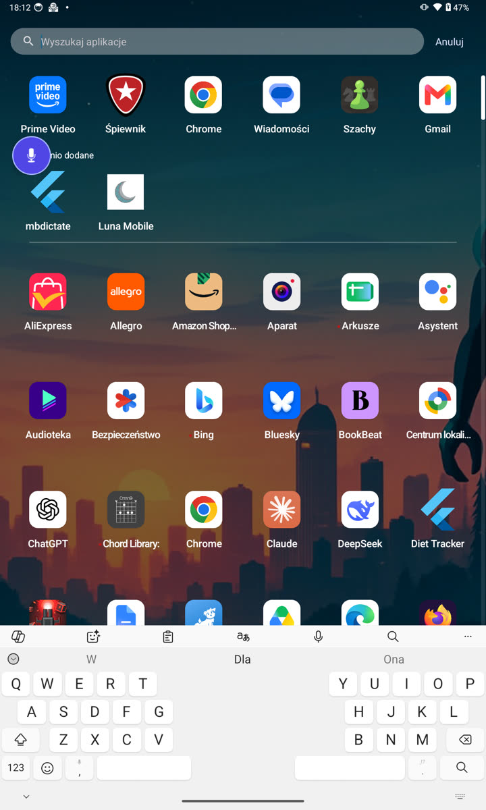
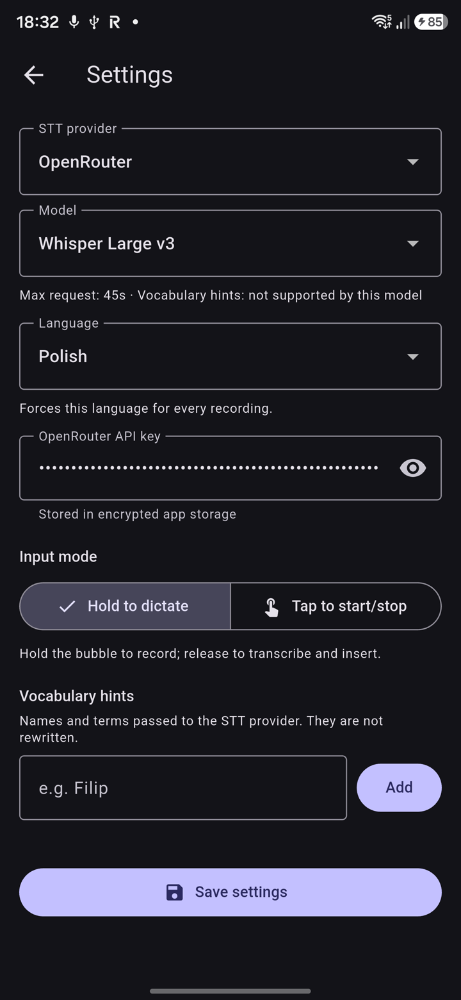

# mbdictate

Android dictation anywhere. Tap or hold a floating bubble over any app, speak,
and the transcript is inserted into the focused text field.

[](https://github.com/digit1024/mbdictate/actions/workflows/ci.yml)
[](https://github.com/digit1024/mbdictate/actions/workflows/release.yml)
[](https://github.com/digit1024/mbdictate/actions/workflows/ci.yml)
[](https://github.com/digit1024/mbdictate/releases)
[](#requirements)

<p align="center">

  
  
</p>

## Features

- **Dictate into any app.** A floating bubble appears only while a text field has
  focus; password fields are ignored.
- **Hold or tap.** Hold-to-dictate, or tap to expand a panel with a live waveform
  and a send button.
- **Bring your own STT provider.** Groq, Qwen/DashScope, OpenRouter or any
  OpenAI-compatible endpoint. Keys are stored with `EncryptedSharedPreferences`.
- **Language auto-detect** or a forced language, plus vocabulary hints (names,
  jargon) for providers that support them.
- **Accessibility insertion** with automatic clipboard fallback when an app
  refuses direct text injection.
- **Long recordings** are chunked to each model's max request length.

## How it works

```
overlay bubble ──▶ DictationController ──▶ AudioRecorder ──▶ SttClient
   (Kotlin)           (Kotlin)              (16 kHz WAV)     (Groq/Qwen/…)
       ▲                                                            │
       │                     DictateAccessibilityService ◀──────────┘
       └───────────── focused-field detection        TextInserter (ACTION_SET_TEXT → clipboard)
```

The Flutter layer is a control panel: permission status, the foreground service
toggle and settings. Recording, transcription and insertion run in Kotlin so they
work without the app in the foreground.

## Supported providers

| Provider | Protocol | Models | Max audio |
| --- | --- | --- | --- |
| Groq | OpenAI transcriptions | Whisper Large v3, Whisper Large v3 Turbo | 300 s |
| Qwen / DashScope | DashScope ASR | Qwen3 ASR Flash | 300 s |
| OpenRouter | OpenAI transcriptions | ElevenLabs Scribe v2, Voxtral Small Transcribe 3, Whisper Large v3, Deepgram Nova 3 | 45 s |
| Custom (OpenAI-compatible) | OpenAI transcriptions | any endpoint + model | 60 s |
| Custom (DashScope) | DashScope ASR | any endpoint + model | 300 s |

**Auto-detect** omits the language hint, so Whisper, Scribe, Voxtral and Qwen3 ASR
(`enable_lid`) infer it per request. Deepgram Nova 3 needs an explicit language.

## Permissions

| Permission | Why |
| --- | --- |
| Microphone | Recording dictation |
| Display over other apps | The floating bubble |
| Accessibility service | Detecting text fields and inserting text |
| Notifications | Keeps the dictation foreground service visible |
| Battery optimization exemption | Stops the service from being killed (recommended) |

Audio is sent only to the provider you configure. There is no intermediary server.

## Install

1. Download the latest `mbdictate-v*.apk` from
   [Releases](https://github.com/digit1024/mbdictate/releases).
2. Sideload it (the release APK is debug-signed, so it is for sideloading —
   not Play Store distribution).
3. Open the app and work through the permission tiles, then add a provider API key
   in **Settings**.

## Build from source

Requirements: Flutter 3.47+ (Dart `^3.13.7`), Android SDK, JDK 17, a device or
emulator with `minSdk` 26.

```bash
flutter pub get
flutter run                  # debug build on the attached device
flutter test                 # Dart unit tests
cd android && ./gradlew testDebugUnitTest   # Kotlin unit tests
```

### Release deployment

`deploy_mobile.sh` builds and installs a release build, similar to the LunaAI
deploy flow:

```bash
./deploy_mobile.sh                        # auto-detect platform
./deploy_mobile.sh --android              # force Android
./deploy_mobile.sh -a -d emulator-5554    # target a device
./deploy_mobile.sh --help
```

On Android it uses `adb install -r`, so app data and granted permissions survive
redeploys, and it re-asserts the accessibility binding afterwards (Android can
leave the service unbound after an app update). Without `adb` it falls back to
`flutter install --release`, which uninstalls first and resets permissions.

## Project layout

```
lib/
  main.dart                      app shell and theme
  screens/home_screen.dart       permission status, service toggle
  screens/settings_screen.dart   provider, model, language, key, vocabulary
  voice/models.dart              provider catalog and settings serialization
  platform/native_bridge.dart    MethodChannel bridge to Kotlin
android/app/src/main/kotlin/com/example/mbdictate/
  MainActivity.kt                Flutter engine, permission plumbing
  DictationService.kt            foreground service
  DictationController.kt         recording → STT → insertion pipeline
  OverlayController.kt           floating bubble UI
  DictateAccessibilityService.kt focus detection (hysteresis state machine)
  focus/FocusDecider.kt          show/hide decision logic
  recording/                     AudioRecorder, WavWriter
  stt/SttClient.kt               OpenAI-compatible and DashScope requests
  insert/TextInserter.kt         direct insert or clipboard fallback
  storage/                       ConfigStore, SecureKeyStore
```

## CI and releases

- `CI` runs `flutter analyze`, Dart tests with coverage, Kotlin unit tests and a
  release APK build on every push and pull request.
- `Release` builds and attaches the APK when a `v*` tag is pushed:

```bash
git tag v1.0.0
git push origin v1.0.0
```

## Known limitations

- Android only; the iOS scaffolding is the Flutter default and has no native
  dictation implementation.
- Release builds are signed with the debug keystore until a real signing config
  is added.
